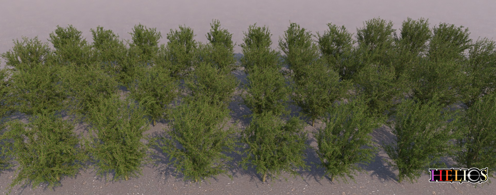

  

For complete documentation of this software, please consult <a href="https://plantsimulationlab.github.io/Helios/">https://plantsimulationlab.github.io/Helios/.

Helios is an open-source C++ and Python framework for building virtual plants, canopies, and landscapes, then simulating the physics and physiology around them.
Grow plants with a procedural plant model, then compute how they intercept light, photosynthesize, transpire, exchange heat, and appear to sensors, from a single leaf to a whole field. 

In order to build and compile the core library, you will need to install a C/C++ compiler (recommended are the GNU C compilers version 7.0+), and CMake. An NVIDIA GPU is not required for most plug-ins. The radiation model uses GPU ray tracing through either a Vulkan backend, which runs on macOS, Linux, and Windows with NVIDIA, AMD, Intel, or Apple GPUs, or an OptiX backend on NVIDIA GPUs with CUDA installed (faster for diffuse and scattering calculations). A few plug-ins (aerial LiDAR, voxel intersection, and wind) still require NVIDIA CUDA. See the [dependent software page](https://plantsimulationlab.github.io/Helios/_dependent_software.html) for installation details. The software has been tested on Linux, Mac, and Windows platforms. The YouTube channel linked above has a number of tutorials for getting started.

**NEW** : Helios now has a Python API! Please see the [PyHelios API documentation](https://plantsimulationlab.github.io/PyHelios/) for more information.

  

## License

Helios is free software licensed under the [GNU Lesser General Public License, version 2.1](LICENSE) or (at your option) any later version (SPDX: `LGPL-2.1-or-later`), except where an individual file states otherwise. Third-party libraries bundled under `lib/` directories retain their own licenses, which are included alongside each library and summarized in [`doc/Helios_ThirdPartyLicenses.txt`](doc/Helios_ThirdPartyLicenses.txt).
